<a href="https://suranga.se">
<picture>
  <source media="(prefers-color-scheme: dark)" srcset="dark_mode.svg">
  <source media="(prefers-color-scheme: light)" srcset="light_mode.svg">
  
</picture>
</a>

### Databricks community

Databricks consultant at Knowit in Malmö, Databricks Solutions Architect Champion and organizer of the [Skåne Databricks User Group](https://usergroups.databricks.com/skane-databricks-user-group/).

- Talks: [NODES 2026](https://www.youtube.com/watch?v=Uw4uy30eRrY), [The Azure and AI Show](https://www.youtube.com/watch?v=4WC5qA9yFso) and more on [Sessionize](https://sessionize.com/Suranga)
- Articles: [Databricks Community](https://community.databricks.com/t5/user/viewprofilepage/user-id/195849)
- Everything in one place: [suranga.se](https://suranga.se/writing/databricks-community-2026/)

<!--
Card layout/portrait: run `python card.py` (manual, needs pillow).
Stats update daily via .github/workflows/update-stats.yml (today.py).
-->
